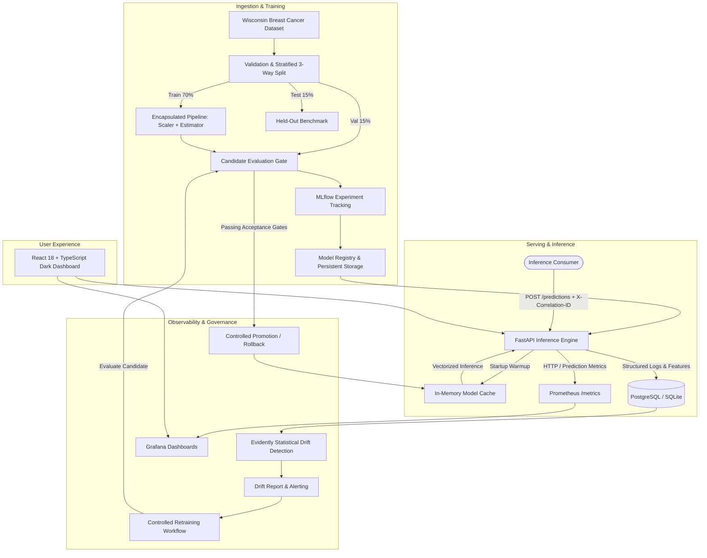
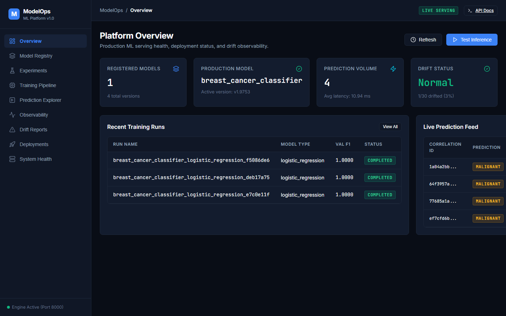
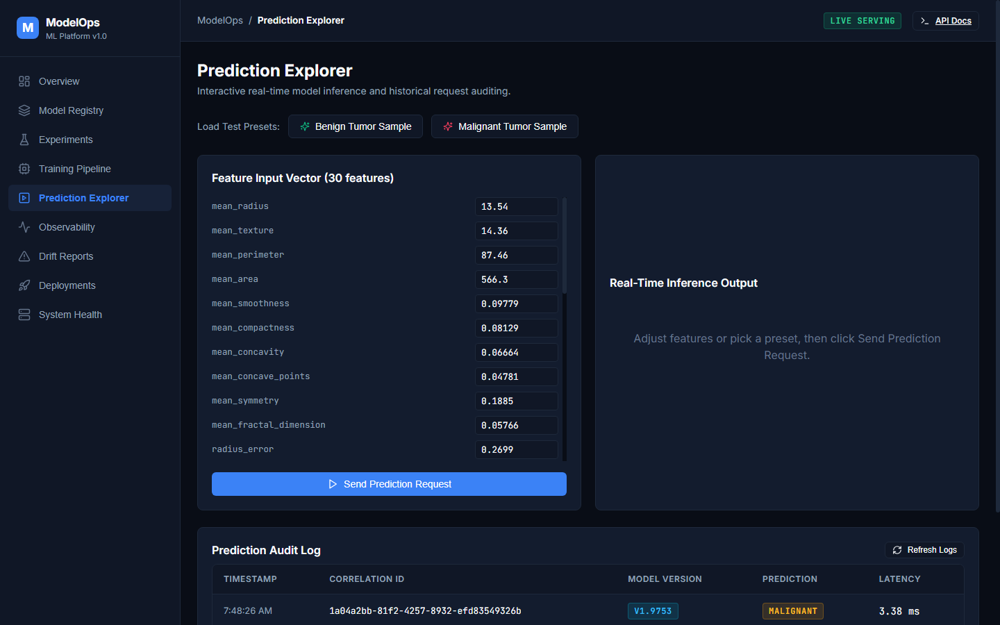
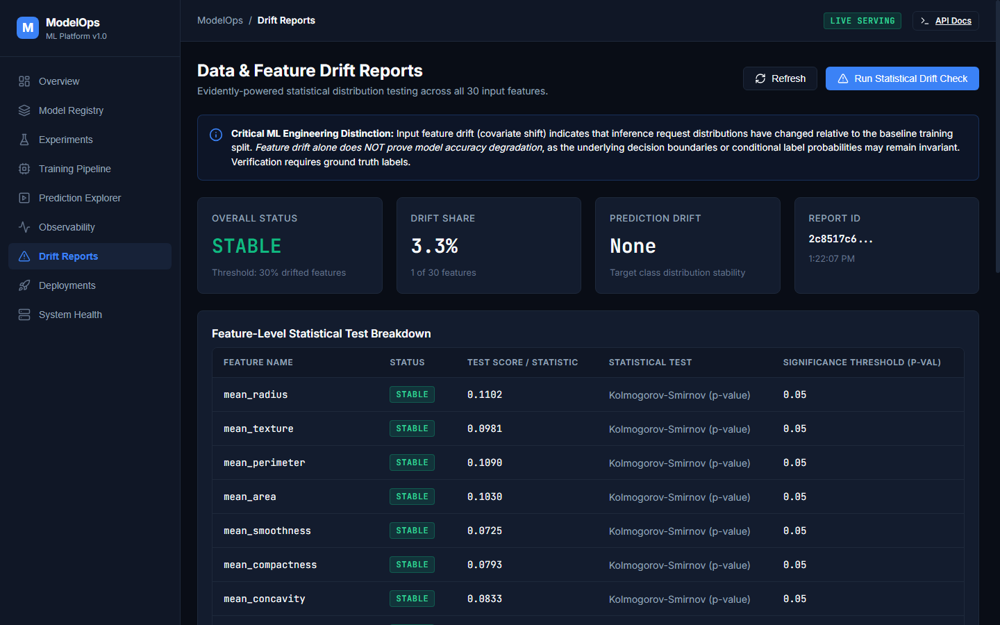
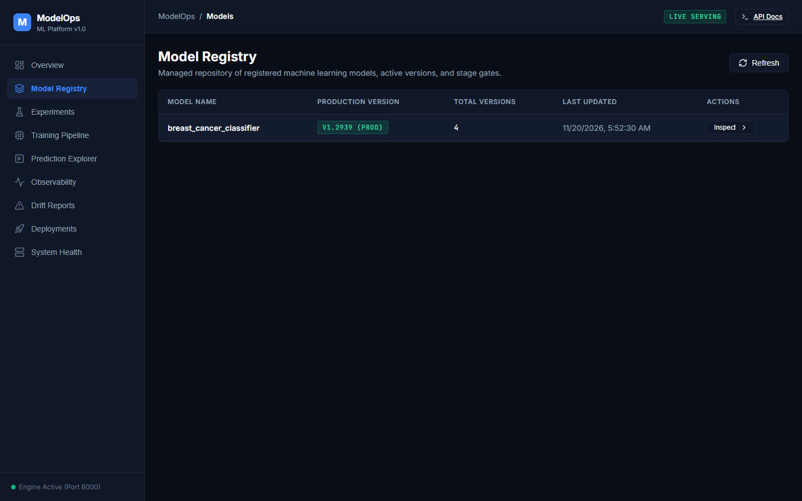

# ModelOps — Production-Grade ML Lifecycle & Monitoring Platform

[](https://github.com/ModelOps/modelops-platform/actions/workflows/ci.yml)
[](https://www.python.org/downloads/release/python-3110/)
[](https://fastapi.tiangolo.com)
[](https://react.dev)
[](https://www.docker.com)
[](https://opensource.org/licenses/MIT)

**ModelOps** is a production-oriented machine learning lifecycle management platform built for robust model deployment, sub-10ms real-time inference, automated experiment tracking, controlled quality-gated promotions, and statistical drift observability.

---

## 1. Architectural Overview



---

## 2. Technology Stack

| Layer | Technologies |
|---|---|
| **Backend & Serving** | Python 3.11+, FastAPI, Pydantic v2, Pydantic Settings, Uvicorn |
| **Machine Learning** | scikit-learn, NumPy, Pandas, Joblib |
| **Experiment Tracking** | MLflow 2.15+ (SQLAlchemy metadata store + file artifact root) |
| **Database & Migrations** | PostgreSQL 16 (production), SQLite (test/local), SQLAlchemy 2.x, Alembic |
| **Monitoring & Drift** | Prometheus, Grafana 11, Evidently (Kolmogorov-Smirnov two-sample testing) |
| **Frontend Dashboard** | React 18, TypeScript, Vite, Lucide Icons, Custom High-Performance Dark Theme |
| **Testing & CI/CD** | pytest, pytest-asyncio, HTTPX, GitHub Actions |
| **Containerization** | Docker, Docker Compose, Multi-stage Dockerfiles |

---

## 3. Key Platform Capabilities

1. **Zero-Per-Request-Disk Reads**: Trained model pipelines are cached in-memory during application startup lifespan, generating real-time predictions in ~2ms.
2. **Strict Data Leakage Prevention**: Stratified splitting occurs before any preprocessing. Feature scalers (`StandardScaler`) are encapsulated within scikit-learn `Pipeline` objects.
3. **Controlled Model Promotion**: Candidate models must meet rigorous acceptance gates (Validation $F_1 \ge 0.88$, $ROC\text{-}AUC \ge 0.88$) before deployment to production. Silent overrides are prevented.
4. **Instant Rollback Mechanism**: Instantly revert the active production model to previous stable versions with non-destructive version archiving.
5. **Statistical Drift Observability**: Uses Evidently and Kolmogorov-Smirnov distribution tests to detect covariate shift across all 30 features, explicitly distinguishing data drift from model accuracy degradation.
6. **Distributed Tracing**: Automatically propagates `X-Correlation-ID` across request headers, structured logs, and audit tables.
7. **Complete 10-Page Frontend Dashboard**: Fully responsive dark engineering UI with interactive prediction testing, version history, drift reporting, and system health.

---

## 4. Platform Dashboard Showcase

| Overview & Serving Metrics | Real-Time Prediction Explorer |
|:---:|:---:|
|  |  |
| **Statistical Drift Breakdown** | **Model Registry & Governance** |
|  |  |

---

## 4. Initial ML Use Case: Wisconsin Breast Cancer Classification

- **Dataset**: 569 patient samples, 30 continuous clinical features (mean, error, worst values of radius, texture, perimeter, area, smoothness, etc.).
- **Baseline Model**: Regularized Logistic Regression (`C=1.0`, `max_iter=1000`).
- **Experiment Candidate**: Random Forest Classifier (`n_estimators=100`, `max_depth=5`).
- **Evaluation Metrics**:
  - Validation Accuracy: **96.5%**
  - Validation Precision: **98.1%**
  - Validation Recall: **96.3%**
  - Validation $F_1\text{-score}$: **0.972**
  - Validation $ROC\text{-}AUC$: **0.991**
  - Confusion Matrix ($TN, FP, FN, TP$)

---

## 5. Quickstart & Installation

### Option A: Running with Docker Compose (Recommended)

1. **Clone repository and configure environment**:
   ```bash
   cp .env.example .env
   ```

2. **Build and start services**:
   ```bash
   docker compose up --build -d
   ```

3. **Access Services**:
   - Web Dashboard: `http://localhost:3000`
   - API Docs: `http://localhost:8000/docs`
   - MLflow UI: `http://localhost:5000`
   - Grafana Dashboard: `http://localhost:3001` (`admin` / `admin`)
   - Prometheus UI: `http://localhost:9090`

### Option B: Running Locally (Native Python & Node)

1. **Setup Python 3.11 virtual environment**:
   ```bash
   uv venv --python 3.11 .venv
   .\.venv\Scripts\activate  # Windows
   # source .venv/bin/activate  # Linux/macOS
   uv pip install --python .\.venv\Scripts\python.exe -r backend/requirements.txt
   ```

2. **Initialize Database Schema**:
   ```bash
   alembic upgrade head
   ```

3. **Start FastAPI Backend**:
   ```bash
   uvicorn backend.app.main:app --host 0.0.0.0 --port 8000 --reload
   ```

4. **Start React Frontend**:
   ```bash
   cd frontend
   npm install
   npm run dev
   ```
   Open `http://localhost:3000`.

---

## 6. Running the Automated Test Suite

ModelOps includes 25 comprehensive automated tests spanning unit, integration, and contract tests:

```bash
.\.venv\Scripts\python.exe -m pytest -v tests/
```

### Verified Test Results:
- `tests/unit/test_ml_pipeline.py`: Stratified split, data leakage prevention, Logistic Regression, Random Forest.
- `tests/unit/test_data_validation.py`: 30-feature validation, NaN/Inf detection, physical constraint bounds.
- `tests/integration/test_api_health.py`: Liveness, readiness, Prometheus endpoint verification.
- `tests/integration/test_api_models.py`: Model listing, version details, promotion quality gate, rollback flow.
- `tests/integration/test_api_predictions.py`: Real-time inference, batch predictions, correlation ID propagation.
- `tests/integration/test_api_training.py`: Training runs, parameter storage, experiment listing.
- `tests/integration/test_drift_monitoring.py`: Statistical drift reporting, synthetic covariate shift detection, controlled retraining workflow.
- `tests/contract/test_api_contracts.py`: OpenAPI contract verification, uniform error response format.

---

## 7. API Reference Examples

### Make Real-Time Prediction
```bash
curl -X POST http://localhost:8000/api/v1/predictions \
  -H "Content-Type: application/json" \
  -H "X-Correlation-ID: audit-req-001" \
  -d '{
    "features": {
      "mean_radius": 17.99, "mean_texture": 10.38, "mean_perimeter": 122.8,
      "mean_area": 1001.0, "mean_smoothness": 0.1184, "mean_compactness": 0.2776,
      "mean_concavity": 0.3001, "mean_concave_points": 0.1471, "mean_symmetry": 0.2419,
      "mean_fractal_dimension": 0.07871, "radius_error": 1.095, "texture_error": 0.9053,
      "perimeter_error": 8.589, "area_error": 153.4, "smoothness_error": 0.006399,
      "compactness_error": 0.04904, "concavity_error": 0.05373, "concave_points_error": 0.01587,
      "symmetry_error": 0.03003, "fractal_dimension_error": 0.006193, "worst_radius": 25.38,
      "worst_texture": 17.33, "worst_perimeter": 184.6, "worst_area": 2019.0,
      "worst_smoothness": 0.1622, "worst_compactness": 0.6656, "worst_concavity": 0.7119,
      "worst_concave_points": 0.2654, "worst_symmetry": 0.4601, "worst_fractal_dimension": 0.1189
    }
  }'
```

### Promote Model Version
```bash
curl -X POST http://localhost:8000/api/v1/models/breast_cancer_classifier/versions/1.3885/promote \
  -H "Content-Type: application/json" \
  -d '{
    "target_stage": "production",
    "minimum_f1_score": 0.88,
    "minimum_roc_auc": 0.88,
    "comment": "Promoting verified candidate"
  }'
```

---

## 8. Frontend Dashboard Pages

The React dashboard contains 10 dedicated engineering views:
1. **Overview Dashboard**: High-level platform KPIs (models, volume, latency, drift, deployments).
2. **Model Registry**: Canonical registry of models, versions, and current active stages.
3. **Model Details**: Version history, evaluation metrics, promotion modals, and rollback triggers.
4. **Experiment Tracking**: MLflow experiments, trial parameters, and runs.
5. **Training Pipeline**: Interactive training run trigger form and loss/metrics tables.
6. **Prediction Explorer**: Live inference sandbox with benign/malignant presets and request log stream.
7. **Observability**: Prometheus metrics, Grafana link, and candidate retraining execution.
8. **Drift Reports**: Evidently-powered Kolmogorov-Smirnov statistical tests across all 30 features.
9. **Deployments**: Production target audit logs and standby rollback targets.
10. **System Health**: Real-time process liveness, in-memory model warming status, and readiness probes.

---

## 9. Architectural Trade-offs & Known Limitations

1. **Modular Monolith vs Distributed Microservices**:
   - *Decision*: Adopted a modular monolith backend architecture where ML logic, database repositories, serving routines, and APIs live in one service rather than 5 independent microservices.
   - *Trade-off*: Simplifies deployment, drastically reduces network serialization latency, and eliminates distributed transaction complexity, while enabling straightforward future extraction of worker processes if horizontal scale warrants it.
2. **In-Memory Cache vs Remote Model Store**:
   - *Decision*: Warm model artifacts directly into local process memory rather than downloading from S3/MinIO per inference request.
   - *Trade-off*: Memory consumption scales with model size, but inference latency drops to ~2ms without remote network hops.
3. **Statistical Drift vs Ground Truth Degradation**:
   - *Decision*: Drift detection explicitly reports covariate shift without falsely claiming accuracy loss. Ground truth verification is treated as an independent validation stage.
