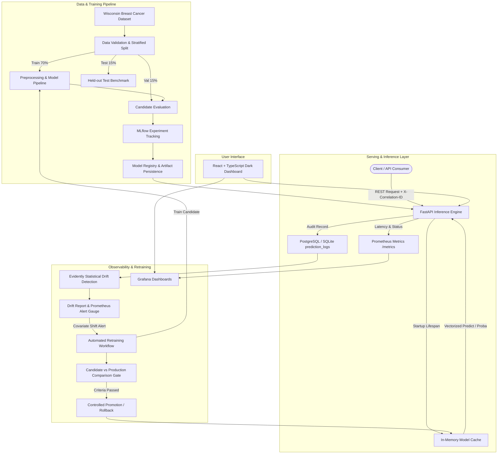

# ModelOps Platform Architecture

## 1. System Overview

ModelOps is a modular, production-grade Machine Learning deployment, serving, and monitoring platform designed for real-time inference, automated experiment tracking, controlled model promotions, and observability.

### Design Principles:
1. **Modular Monolith First**: Avoid premature distributed microservices overhead while maintaining strict internal separation between the ML Domain, Persistence Layer, Inference Engine, and Presentation API.
2. **Zero In-Request Disk Reads**: Active production models are warmed into in-memory cached singletons during startup lifespan to achieve sub-10ms response latencies.
3. **Strict Data Leakage Prevention**: Data splits (70% train, 15% validation, 15% held-out test) occur strictly before any preprocessing. All scalers (`StandardScaler`) are encapsulated within scikit-learn `Pipeline` objects.
4. **Controlled Promotion Gates**: Never silently overwrite production models. Model promotions require explicit metric criteria (Validation F1 >= threshold, ROC-AUC >= threshold) and preserve full rollback capability.
5. **Observability & Traceability**: High-resolution latency profiling, Prometheus metrics counters/histograms, correlation ID headers (`X-Correlation-ID`) across every layer, and Evidently statistical drift analysis.

---

## 2. End-to-End Architectural Flow

---

## 3. Core Subsystems

### 3.1. API & Serving Layer (FastAPI)
- **Asynchronous Execution & Concurrency**: Powered by Starlette and Uvicorn.
- **Correlation ID Middleware**: Automatically extracts or generates an RFC4122 UUID correlation ID per request, setting it in request state, log context, and response headers (`X-Correlation-ID`).
- **Structured JSON Logging**: Custom JSON logger emits machine-readable log records with correlation IDs, latency metrics, and exception traces.
- **Uniform Error Handling**: Global exception handlers prevent internal stack trace leakage in production.

### 3.2. Machine Learning Pipeline (scikit-learn)
- **Dataset**: Wisconsin Breast Cancer classification (30 continuous numerical features, binary diagnosis).
- **Preprocessing**: `StandardScaler` strictly bundled inside `sklearn.pipeline.Pipeline`.
- **Estimators**:
  - `LogisticRegression(C=1.0, max_iter=1000)` (Baseline)
  - `RandomForestClassifier(n_estimators=100, max_depth=5)` (Experiment candidate)
- **Validation Strategy**: Stratified 3-way split with fixed seeds. Validation split is dedicated to tuning and promotion evaluation; the test split is preserved for final held-out reporting.

### 3.3. Persistence & Database (SQLAlchemy 2.x & Alembic)
- **Relational Tables**:
  - `experiments`: High-level study metadata.
  - `training_runs`: Detailed run records, hyperparameter JSON, metric JSON, duration.
  - `registered_models`: Entity definitions.
  - `model_versions`: Version history with candidate/staging/production/archived states.
  - `deployments`: Audit trail of promotions and rollbacks.
  - `prediction_logs`: Real-time request features, output labels, probabilities, latency.
  - `monitoring_reports`: Statistical drift summaries and p-value evaluations.
- **Alembic Migrations**: Fully versioned schema evolution with zero-downtime compatibility.

### 3.4. Monitoring, Drift Detection & Grafana
- **Evidently Integration**: Runs Kolmogorov-Smirnov (KS) two-sample tests across all 30 features comparing reference baseline distributions with recent prediction logs.
- **Conceptual Clarity**: Explicitly distinguishes between **Data Drift** (input covariate shift), **Prediction Drift** (output label ratio change), and **Performance Degradation** (loss of accuracy against true labels).
- **Prometheus Metrics**:
  - `modelops_http_requests_total`
  - `modelops_http_request_duration_seconds`
  - `modelops_predictions_total`
  - `modelops_prediction_duration_seconds`
  - `modelops_active_model_version`
  - `modelops_drift_detected`

### 3.5. React + TypeScript Dashboard
- Engineered dark-mode interface built with Vite, React 18, and Lucide icons.
- 10 comprehensive views covering the entire ML lifecycle.
