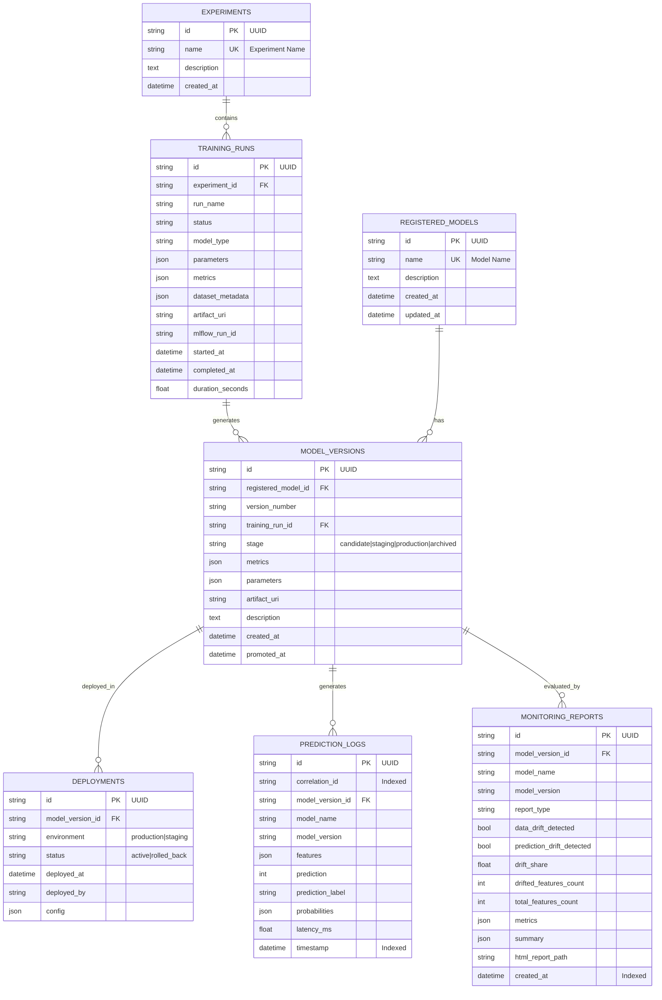

# ModelOps Database Schema & Migrations

The platform utilizes **SQLAlchemy 2.x** declarative mapping and **Alembic** for schema migrations.

---

## 1. Entity-Relationship Diagram



---

## 2. Table Specifications & Indexes

### `experiments`
- `id` (VARCHAR(36), PK): UUID.
- `name` (VARCHAR(100), UNIQUE, INDEX): Human-readable experiment identifier.
- `created_at` (TIMESTAMPTZ): Ingestion timestamp.

### `training_runs`
- `id` (VARCHAR(36), PK): Unique run identifier.
- `experiment_id` (VARCHAR(36), FK -> `experiments.id`, ON DELETE CASCADE, INDEX).
- `parameters` (JSON): Hyperparameter key-value dictionary.
- `metrics` (JSON): Validation F1, ROC-AUC, accuracy, confusion matrix.
- `mlflow_run_id` (VARCHAR(100), INDEX): Link to external MLflow tracking instance.

### `registered_models`
- `id` (VARCHAR(36), PK): Unique model entity ID.
- `name` (VARCHAR(100), UNIQUE, INDEX): Canonical model namespace.

### `model_versions`
- `stage` (VARCHAR(50), INDEX): Lifecycle stage (`candidate`, `staging`, `production`, `archived`, `rejected`).
- Foreign key relationships to `registered_models` and `training_runs`.

### `prediction_logs`
- `correlation_id` (VARCHAR(100), INDEX): Enables end-to-end tracing across distributed microservices.
- `timestamp` (TIMESTAMPTZ, INDEX): Optimized for time-series range queries and drift calculation.

---

## 3. Migration Strategy with Alembic

1. **Creating Migrations**:
   ```bash
   alembic revision --autogenerate -m "Add new column"
   ```
2. **Applying Migrations**:
   ```bash
   alembic upgrade head
   ```
3. **Downgrading Migrations**:
   ```bash
   alembic downgrade -1
   ```
4. **Production Guidelines**:
   - Never edit an existing migration script that has already been deployed to staging or production.
   - Always run pre-deployment checks against an isolated staging replica.
