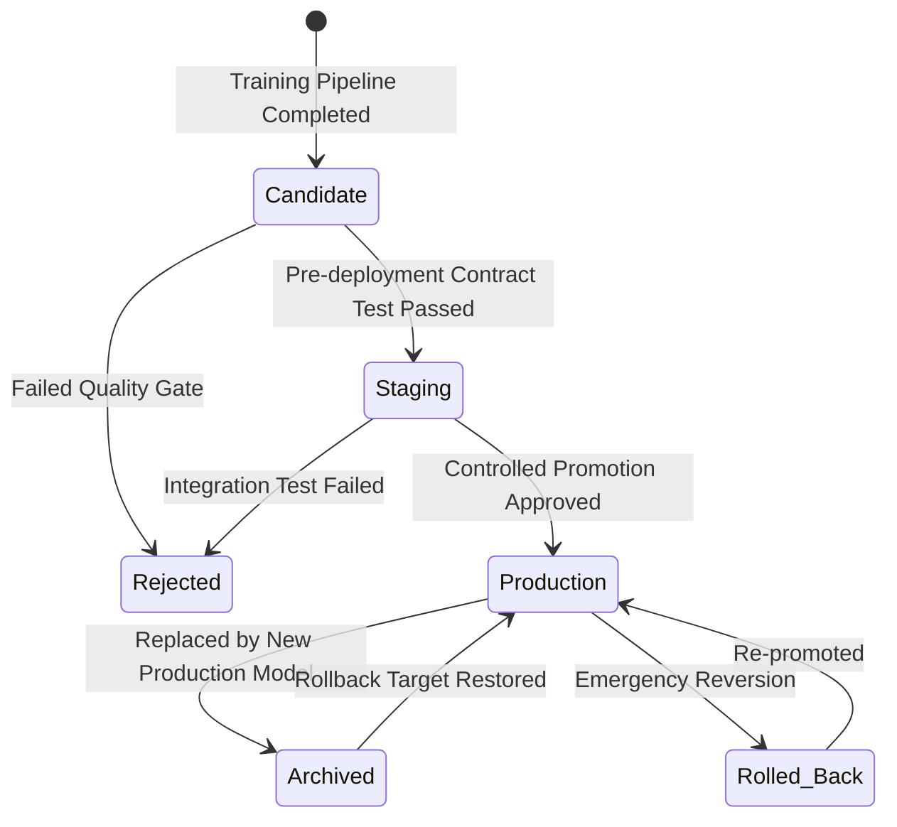

# Model Lifecycle Management & Controlled Promotion

In production machine learning systems, deploying models without rigorous validation risks silent failures, catastrophic performance regression, and loss of business trust. ModelOps enforces an explicit, auditable model lifecycle.

---

## 1. Lifecycle State Machine

---

## 2. Stage Definitions

| Stage | Purpose | Accessibility |
|---|---|---|
| `candidate` | Initial state immediately after training and artifact validation. | Private to experimentation team. |
| `staging` | Tested in isolated staging environment against synthetic shadow traffic. | Internal integration clients. |
| `production` | Active serving version queried by the `/predictions` endpoint. | Public API clients. |
| `archived` | Previously deployed production model kept on standby for rollback. | Archived from default routing. |
| `rejected` | Model version failed automated quality gates or metric thresholds. | Inactive. |

---

## 3. Data Leakage Prevention

Data leakage occurs when information from outside the training dataset is inadvertently used to create the model. ModelOps employs three strict guardrails:

1. **Stratified Split Before Preprocessing**:
   Data is split into **70% Train**, **15% Validation**, and **15% Test** splits before any mean or standard deviation calculations.
2. **Encapsulated Pipelines**:
   Feature scalers (`StandardScaler`) are encapsulated within `sklearn.pipeline.Pipeline`. Preprocessing parameters (`mean_`, `scale_`) are fitted solely on `X_train`. When `.predict()` is invoked on validation or production data, the pre-fitted parameters are applied without refitting.
3. **Strict Validation vs Test Isolation**:
   Hyperparameter exploration and candidate selection criteria exclusively utilize the **Validation Split**. The **Test Split** is evaluated only after model training to produce unbiased benchmark numbers.

---

## 4. Controlled Promotion Gate Workflow

Promotion from `candidate` to `production` requires explicit verification:

1. **Quality Criteria Verification**:
   - `Validation F1 Score >= minimum_f1_score` (Default: 0.88)
   - `Validation ROC-AUC >= minimum_roc_auc` (Default: 0.88)
   - `Validation Accuracy >= baseline`
2. **Atomic Transition**:
   - The candidate version's stage is set to `production` and `promoted_at` timestamp is stamped.
   - The previous production model version is demoted to `archived`.
   - A new record is inserted into the `deployments` audit table.
   - The in-memory model cache is updated with the new model weights.
   - The Prometheus gauge `modelops_active_model_version` is updated.
3. **Emergency Override**:
   - In critical scenarios, an authorized engineer can pass `"force": true` to bypass metric gates, with an explicit audit log reason required.

---

## 5. Rollback Workflow

If unexpected regressions occur in production:
1. The rollback endpoint `POST /api/v1/models/{model_id}/rollback` identifies the previous active production version from the `deployments` table.
2. The current production version is flagged as `rolled_back`.
3. The previous stable version is re-promoted to `production`.
4. In-memory serving cache updates instantaneously without process restart or downtime.
